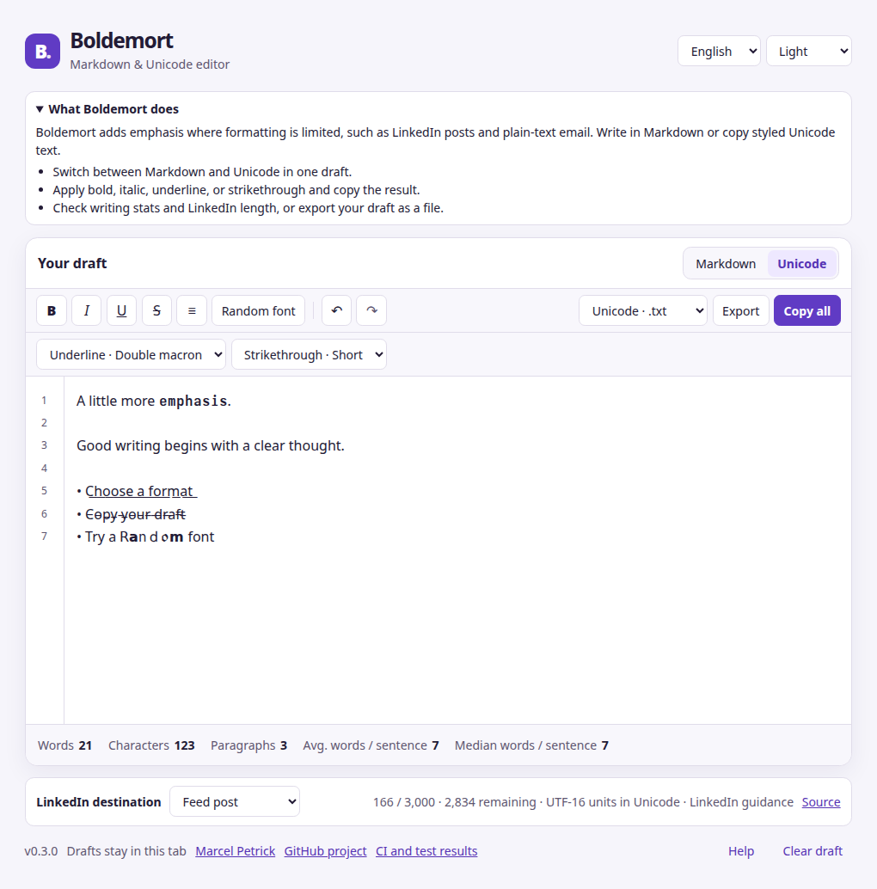
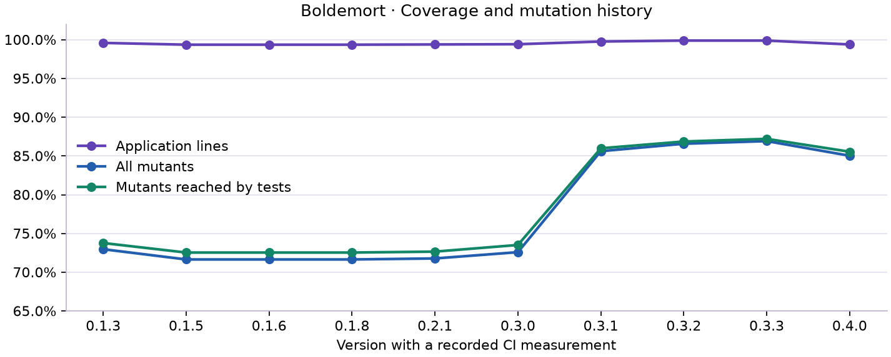

# Boldemort

[](https://github.com/marcelpetrick/Boldemort/actions/workflows/ci.yml)
[](https://github.com/marcelpetrick/Boldemort/actions/workflows/pages.yml)
[](https://github.com/marcelpetrick/Boldemort/actions/workflows/release.yml)
[](docs/CHANGELOG.md)
[](LICENSE)
[](https://www.typescriptlang.org/)
[](https://vite.dev/)
[](https://github.github.com/gfm/)
[](#local-development)
[](#local-development)
[](https://playwright.dev/)
[](#using-the-editor)
[](#using-the-editor)

Boldemort is a one-editor writing tool that converts compatible Markdown
formatting to copyable Unicode and back. It runs entirely in the browser.

**[Try Boldemort on GitHub Pages](https://marcelpetrick.github.io/Boldemort/)**

**Author: Marcel Petrick <mail@marcelpetrick.it>**

**License: [GPL v3 or later](LICENSE).**

**Developed with AI assistance.**

See the [requirements](docs/REQUIREMENTS.md),
[dependency inventory](docs/DEPENDENCIES.md), [implementation plan](docs/PLAN.md),
and [project vision](vision.md).



[Dark theme](media/editor-dark.png) · [Bavarian theme](media/editor-bavarian.png)

## Using the editor

1. Write or paste into the draft. Select text to format it, or toggle a style
   at the caret to apply it to subsequent typing.
2. Switch between **Markdown** and **Unicode** to edit either representation.
3. Choose an **output format**, then use **Copy all** or **Export**. Copy and
   download use the chosen format regardless of which view is open.

The Unicode line controls default to short strikethrough and double macron
underline. Choose long or tilde strikethrough, low line, or double underline
as needed. Existing text keeps its original marks. The exact marks may render
differently across fonts and platforms.

The LinkedIn selector gives an advisory length estimate in UTF-16 code units
for the chosen output. Reported and conservative limits are labeled. Word and
sentence statistics use parsed text. Character count uses visible grapheme
clusters when supported. A nonempty top-level Markdown block counts once.

In Unicode mode, **Random font** mixes Unicode alphabets in a selection or
toggles mixed lettering for new typing. Undo restores a transformed selection.

The top bar has English and German and follows the system theme unless you
select Light, Dark, or Bavarian. Hover or focus a control for brief help.
Keep the pointer or focus there for four seconds to expand it, or open
**Help** to read the full explanations.

The Unicode representation retains complex Markdown syntax such as links, code,
tables and task lists literally. Simple unordered lists switch between
Markdown markers and Unicode bullets. Edits in the other view preserve source
spellings when the same conversion span is still recognized. Browser text
input normalizes line endings to LF. Mathematical letters, combining marks
and Markdown can be interpreted differently by external applications.
Drafts live in the current tab. Export a copy to keep one.

## Repository layout

- [Application source](src/) and [browser and unit tests](tests/)
- [Tool configuration](config/) and [maintenance scripts](scripts/)
- [Project documentation](docs/) and [editor screenshots](media/)

## Local development

Requires Node.js 24 or later and npm.

```sh
npm ci
npm run dev
```

```sh
./localPipeline.sh
```

The pipeline installs the locked npm dependencies and Playwright browser
binaries from a fresh checkout. It checks formatting, TypeScript, CSS, HTML,
Markdown, the dependency inventory and audit results, then runs unit coverage,
the production build, and Playwright against the GitHub Pages subpath. The
coverage gate requires at least 98% line coverage across the application
TypeScript modules.
Run `npm run performance` to check the long-draft workloads and their output
locally. The shared pipeline runs the same gate in GitHub Actions. See the
[profiling results and budgets](docs/PERFORMANCE.md).
Run `npm run mutation` for Stryker mutation testing of the conversion and
analysis core. It runs on a sandbox copy, reports to `reports/mutation/`, and
requires an overall mutation score of at least 80%.
ShellCheck and actionlint run when installed. Unit coverage is reported in
`coverage/`. Browser instrumentation uses a
separate build directory and is excluded from Pages and release artifacts.

On supported Linux hosts, Playwright can install system libraries with
`npx playwright install --with-deps chromium firefox webkit` after the npm
dependencies are installed. Alternatively, run the full pipeline in the same
Playwright container as CI.

```sh
docker run --rm --ipc=host --user "$(id -u):$(id -g)" \
  --env npm_config_cache=/tmp/boldemort-npm-cache \
  --volume "$PWD:/work" --workdir /work \
  mcr.microsoft.com/playwright:v1.65.1-noble ./localPipeline.sh
```

Use `./localPipeline.sh --project=chromium --project=firefox` to select which
engines run the production browser tests.

`npm run build` writes static files to `dist/`. Run `npm run preview` to serve
the build locally. For the Pages subpath, run `node scripts/serve.mjs` after
building, then open <http://127.0.0.1:4173/Boldemort/>.

## GitHub Pages and releases

Set **Settings → Pages → Source** to **GitHub Actions** and the Actions variable
`PAGES_ENABLED` to `true` to enable public deployment. Successful main-branch
CI triggers Pages deployment. The Pages workflow can also be dispatched for
the current tip of `main`.

For a release, update the package version and changelog, verify the pipeline,
then push a matching tag such as `v0.2.1` from `main`. The release workflow
reruns local verification, packages the static site with licensing information,
and publishes a SHA-256 checksum alongside the archive. Dispatch the Release
workflow on `main` to verify and download the archive from Actions without
creating a GitHub release.

## History




The coverage chart uses published CI measurements through v0.3.1. The data
file records run IDs for each sample. The code chart counts physical lines
in tracked app files and tests at each version through the same revision.
It excludes dependencies, generated output, and documentation.

Redraw both charts with Python and Matplotlib 3.11.2.

```sh
python3 scripts/history_charts.py
```

See the [coverage data](docs/coverage-history.csv) and
[release history](docs/CHANGELOG.md).
