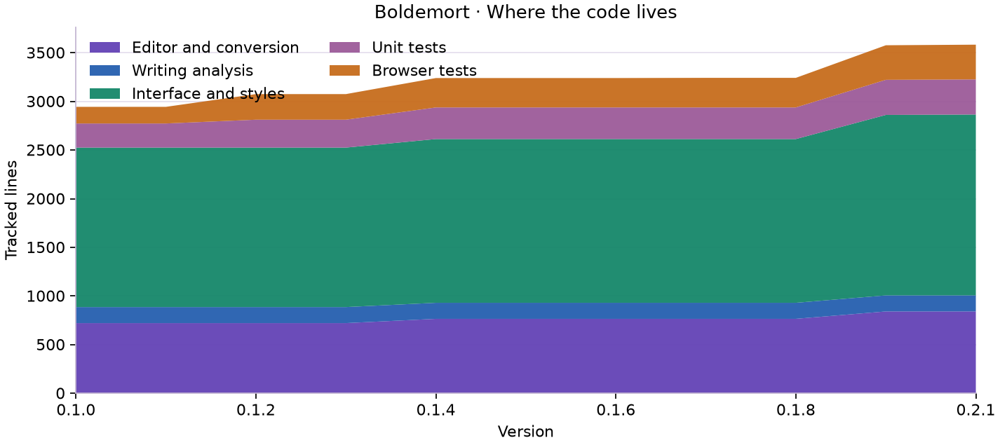

# Boldemort

[](https://github.com/marcelpetrick/Boldemort/actions/workflows/ci.yml)
[](https://github.com/marcelpetrick/Boldemort/actions/workflows/pages.yml)
[](https://github.com/marcelpetrick/Boldemort/actions/workflows/release.yml)
[](docs/CHANGELOG.md)
[](LICENSE)
[](https://www.typescriptlang.org/)
[](https://vite.dev/)
[](https://github.github.com/gfm/)
[](#local-development)
[](#local-development)
[](https://playwright.dev/)
[](#using-the-editor)
[](#using-the-editor)

Give a LinkedIn post or plain-text email a little emphasis. Write in Markdown,
switch to copyable Unicode, and keep editing in the same draft. Boldemort
processes your text in the browser without sending it to a server.

**[Try Boldemort on GitHub Pages](https://marcelpetrick.github.io/Boldemort/)**

**Author: Marcel Petrick <mail@marcelpetrick.it>**

**License: [GPL v3 or later](LICENSE).**

**Developed with AI assistance.**


[Dark theme](media/editor-dark.png) · [Bavarian theme](media/editor-bavarian.png)

[Watch Markdown to copyable Unicode](media/linkedin-formatting.gif) ·
[Watch Random font turn on and off](media/linkedin-random-font.gif) ·
[Read the demo storyboards](docs/DEMO.md)

## Using the editor

1. Write or paste into the draft. Select text to format it, or toggle a style
   with no selection to format what you type next.
2. Switch between **Markdown** and **Unicode** to edit either representation.
3. Choose Markdown or Unicode in the output picker, then use **Copy all** or
   **Export**. The picker controls what you copy or download.

Keyboard shortcuts work while the draft has focus. On macOS, use Cmd in
place of Ctrl.

| Action        | Shortcut               |
| ------------- | ---------------------- |
| Bold          | Ctrl+B                 |
| Italic        | Ctrl+I                 |
| Underline     | Ctrl+U                 |
| Strikethrough | Ctrl+Shift+X           |
| Bulleted list | Ctrl+Shift+8           |
| Undo          | Ctrl+Z                 |
| Redo          | Ctrl+Shift+Z or Ctrl+Y |

The Unicode line controls default to short strikethrough and double macron
underline. Choose a different line to use on new formatting. Existing text
keeps its marks. Fonts and apps may display the lines differently.

Choose a LinkedIn destination for an estimated length limit. The estimate uses
UTF-16 code units, so one visible character may count as more than one unit.
The writing stats count words and sentences in the text and count each
nonempty top-level Markdown block as one paragraph.

In Unicode mode, **Random font** mixes Unicode alphabets in a selection or
toggles mixed lettering for new typing. Click again on the randomized selection
to restore plain Latin letters and digits. Select all to format across the
draft while preserving protected Markdown and code.

Choose English or German and a theme in the top bar. Hover or focus a control
for a short hint. It expands after four seconds. Open **Help** by the editor to
read the full explanations.

Links, code, tables, and task lists keep their original Markdown when you
switch to Unicode. Simple unordered lists become Unicode bullets. Nested and
numbered lists keep their markers, and their item text can still be
formatted. After an edit in the other view, the editor keeps the original
Markdown spelling where it still recognizes the same span. Browser text input
uses LF line endings.

**Save draft locally** is on by default. Reload or reopen the same URL in
the same browser profile to recover your draft and editing mode. Turning
saving off deletes the saved copy immediately and leaves the text in your
open tab. Turning it back on saves the text you are editing. **Clear draft**
also deletes the saved copy after confirmation. Undo history starts fresh on
each load. If you edit in several tabs, the last saved change is the one
you'll see when you reopen the site. Use **Export** for a separate file copy.

## Repository layout

- [Architecture and diagrams](docs/ARCHITECTURE.md), [product vision](vision.md),
  and [implementation plan](docs/PLAN.md)
- [Application source](src/), [tests](tests/), [tool configuration](config/), and
  [maintenance scripts](scripts/)
- [Requirements and checks](docs/REQUIREMENTS.md),
  [dependency inventory](docs/DEPENDENCIES.md), and [editor media](media/)

## Local development

Use Node.js 24.22.3 and npm to match CI.

```sh
npm ci
npm run dev
```

```sh
./localPipeline.sh
```

The shared local and GitHub Actions pipeline installs the locked dependencies
and Playwright browsers. It checks source, documentation, dependencies, and
long-draft performance, builds the site, and tests it at the Pages subpath.
Every application module must reach 100% line, statement, branch, and
function coverage from unit and browser tests combined. The pipeline also
runs ShellCheck and actionlint when installed.

- Run `npm run performance` for the [long-draft checks](docs/PERFORMANCE.md).
- Run `npm run mutation` to test the conversion and analysis core in a sandbox.
  The minimum score is 80%, and reports go to `reports/mutation/`.

On supported Linux hosts, Playwright can install system libraries with
`npx playwright install --with-deps chromium firefox webkit` after the npm
dependencies are installed. Alternatively, run the full pipeline in the same
Playwright container as CI.

```sh
docker run --rm --ipc=host --user "$(id -u):$(id -g)" \
  --env npm_config_cache=/tmp/boldemort-npm-cache \
  --volume "$PWD:/work" --workdir /work \
  mcr.microsoft.com/playwright:v1.65.1-noble ./localPipeline.sh
```

Use `./localPipeline.sh --project=chromium --project=firefox` to select which
engines run the production browser tests.

`npm run build` writes static files to `dist/`. Run `npm run preview` to serve
the build locally. For the Pages subpath, run `node scripts/serve.mjs` after
building, then open <http://127.0.0.1:4173/Boldemort/>.

## GitHub Pages and releases

Set **Settings → Pages → Source** to **GitHub Actions** and the Actions variable
`PAGES_ENABLED` to `true` to enable public deployment. Successful main-branch
CI triggers Pages deployment. The Pages workflow can also be dispatched for
the current tip of `main`.

For a release, update the package version and changelog, verify the pipeline,
then push a matching tag such as `v0.2.1` from `main`. The release workflow
reruns local verification, packages the static site with licensing information,
and publishes a SHA-256 checksum alongside the archive. Dispatch the Release
workflow on `main` to verify and download the archive from Actions without
creating a GitHub release.

## History




The charts run through the last recorded v0.4.0 build. The coverage chart
uses CI results. The code chart counts lines in tracked app files and tests.

Redraw both charts with Python and Matplotlib 3.11.2.

```sh
python3 scripts/history_charts.py
```

See the [coverage data](docs/coverage-history.csv) and
[release history](docs/CHANGELOG.md).
