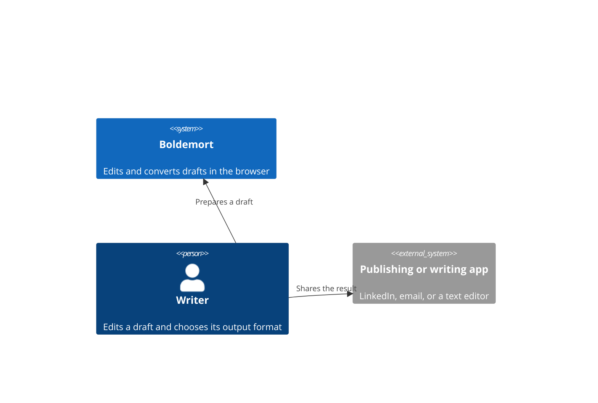
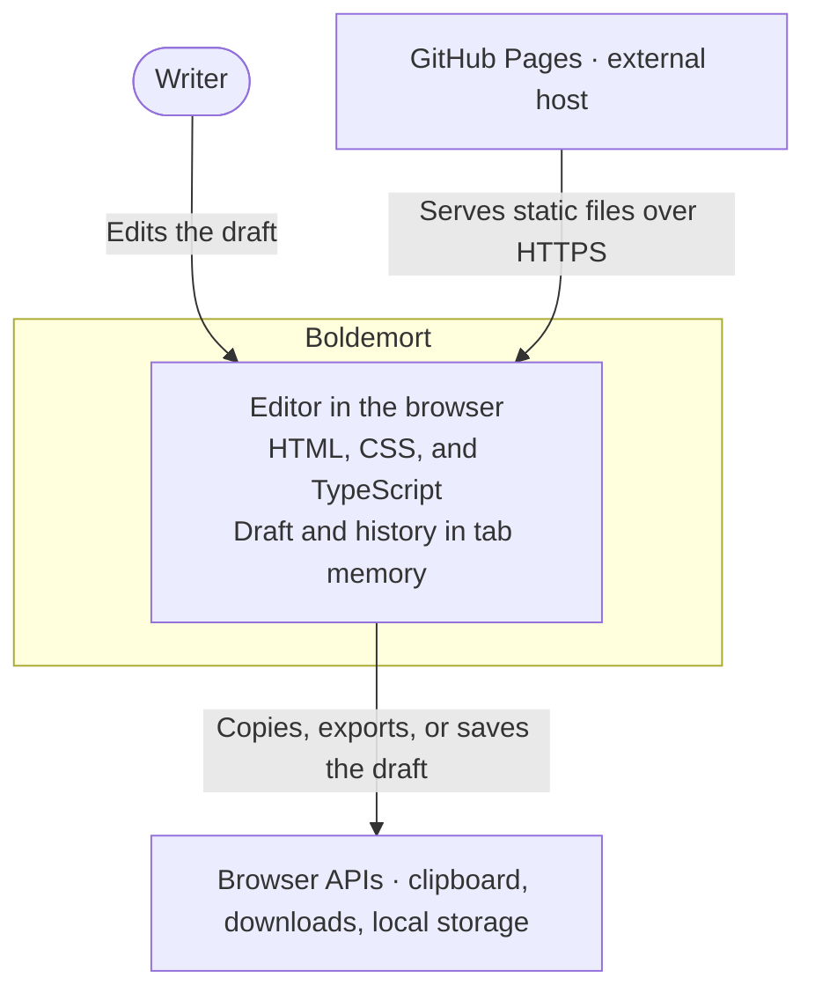
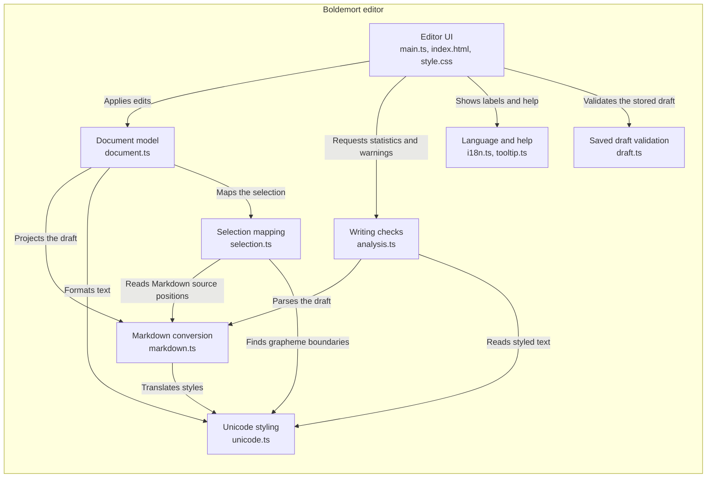
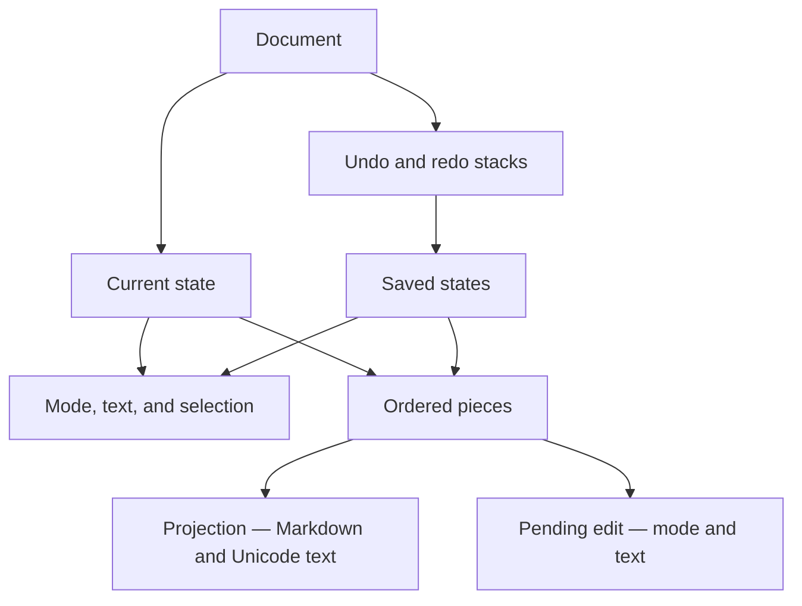
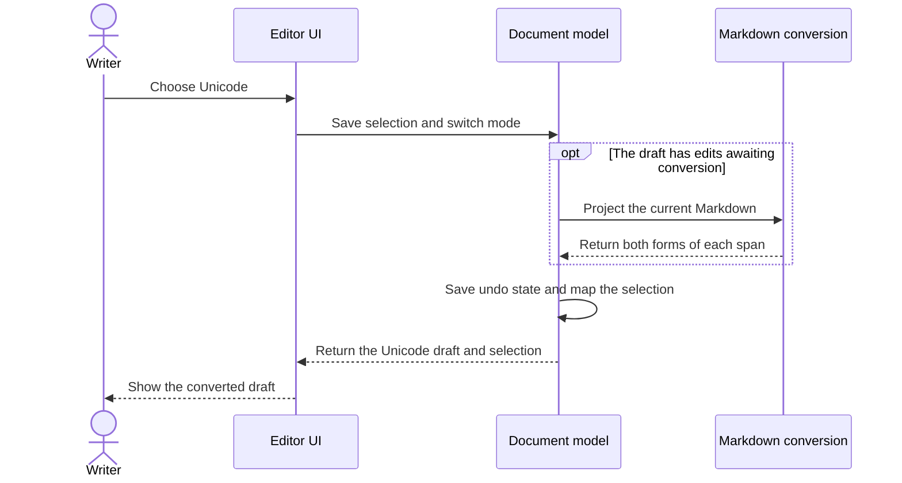

# Boldemort architecture

<!-- markdownlint-configure-file { "MD013": { "code_blocks": false } } -->

Boldemort saves one draft in the browser by default. The writer can edit it as
Markdown or Unicode, then copy or download either form. GitHub Pages serves
the app files. The browser handles the draft, undo history, and writing
checks locally.

The diagrams follow the [C4 model](https://c4model.com/diagrams).

## 1. System context

The writer brings text into Boldemort and moves the result to the next app.
LinkedIn, email, and other destinations receive text when the writer pastes or
opens an exported file.

## 2. Containers

The editor is the single application container. GitHub Actions builds its
static files and GitHub Pages serves them. The editor uses browser APIs for
clipboard access, downloads, and local storage. On startup the editor reads
the saved draft from the same browser profile.

## 3. Components

The UI sends edits and selection changes to the document model. The model
owns the draft and its history. Markdown conversion and Unicode styling
operate on text, so they can be tested without a browser. The writing checks
and UI also use the Markdown parser and Unicode helpers for notices, writing
statistics, and the visible character count.

The draft reader validates the stored mode, line styles, and ordered pieces.
Restoring these pieces preserves both exact spellings and pending edits
without restoring the undo stack. A versioned storage key holds either one
snapshot or the off preference. Open tabs read the preference when storage
changes and check it before saving.

## 4. Code view of the document model

Each history entry captures the mode, text, selection, and pieces of the draft.
A piece holds either both forms of a source span or an edit recorded in the
current mode. During conversion the model can reuse the exact earlier
spelling when the parser still recognizes that span. Complex Markdown such as
links and fenced code stays literal.

## Switching from Markdown to Unicode

The editor matches visible characters across the two views. It uses Markdown
source positions to skip formatting delimiters. If the two forms cannot be
matched character by character, the caret snaps to the nearest estimated
grapheme boundary.

See the [product vision](../vision.md) for the conversion guarantees and
the [README](../README.md#local-development) for build and test commands.
